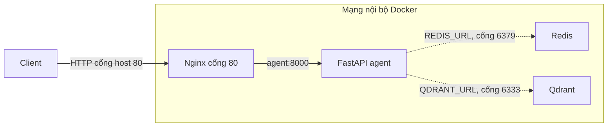

# Day 14 Lab — Mission Answers

## Part 1 — Localhost vs Production

### Exercise 1.1 — Anti-pattern trong bản develop

1. **Thông tin xác thực đặt trong mã nguồn.** `OPENAI_API_KEY` và chuỗi kết nối DB chứa thông tin đăng nhập nằm ngay trong module. Với thông tin thật, mọi người có quyền đọc repo hoặc lịch sử Git đều có thể thấy chúng. Việc đổi giá trị cũng kéo theo sửa mã và triển khai lại. [Dòng 17–18](01-localhost-vs-production/develop/app.py#L17-L18)
2. **Log chứa dữ liệu nhạy cảm.** `print()` in trực tiếp key, câu hỏi và câu trả lời. Bất kỳ bản sao log nào chuyển sang hệ thống tập trung cũng mang theo những dữ liệu đó. [Dòng 33–38](01-localhost-vs-production/develop/app.py#L33-L38)
3. **Log tự do bằng `print()`.** Các dòng debug thiếu timestamp và cấu trúc trường ổn định. Khi nhiều instance cùng ghi log, việc lọc sự kiện hoặc đối chiếu trình tự request khó hơn. [Dòng 33–38](01-localhost-vs-production/develop/app.py#L33-L38)
4. **Địa chỉ bind cố định là `localhost`.** Trong container, process chỉ nghe trên loopback của chính container. Reverse proxy ở bên ngoài container sẽ khó kết nối đến app theo cấu hình này. [Dòng 51](01-localhost-vs-production/develop/app.py#L51)
5. **Cổng `8000` gắn trực tiếp trong lệnh chạy.** Nếu nền tảng cấp cổng qua biến `PORT`, app vẫn mở cổng cũ. Health check và routing có thể thất bại dù process đã khởi động. [Dòng 52](01-localhost-vs-production/develop/app.py#L52)
6. **Tự reload luôn bật.** File watcher làm phát sinh process giám sát và có thể khiến worker restart khi source thay đổi. Cấu hình này tiện khi sửa code local. [Dòng 53](01-localhost-vs-production/develop/app.py#L53)
7. **Thiếu probe và hook vòng đời của app.** Bản develop chỉ có `/` và `/ask`. Hệ thống vận hành thiếu tín hiệu riêng để biết app còn sống hay đã sẵn sàng nhận traffic. Mã app cũng chưa có chỗ khai báo cleanup riêng khi server dừng. [Dòng 25–43](01-localhost-vs-production/develop/app.py#L25-L43)

### Exercise 1.2 — Chạy bản develop

Chạy `python app.py` trong `01-localhost-vs-production/develop` bằng Python 3.11.18 trên Ubuntu WSL2. Gửi câu hỏi qua query parameter, đúng với chữ ký hàm `ask_agent(question: str)`.

```bash
curl -sS -w '\nHTTP %{http_code}\n' -X POST 'http://127.0.0.1:8000/ask?question=Hello'
```

Kết quả lần chạy ngày 25/11/2026:

```text
{"answer":"Đây là câu trả lời từ AI agent (mock). Trong production, đây sẽ là response từ OpenAI/Anthropic."}
HTTP 200
```

### Exercise 1.3 — Chạy và so sánh bản production

Dừng bản develop để giải phóng cổng `8000`. Chạy `HOST=127.0.0.1 PORT=8000 DEBUG=false ENVIRONMENT=development python app.py` trong `01-localhost-vs-production/production`, với cấu hình local và mock LLM. Các request sau đều dùng `http://127.0.0.1:8000`.

```bash
curl -sS -w '\nHTTP %{http_code}\n' http://127.0.0.1:8000/health
curl -sS -w '\nHTTP %{http_code}\n' http://127.0.0.1:8000/ready
curl -sS -w '\nHTTP %{http_code}\n' -X POST http://127.0.0.1:8000/ask \
  -H 'Content-Type: application/json' -d '{"question":"Hello"}'
```

| Request | HTTP | Body thực tế |
| --- | --- | --- |
| `GET /health` | 200 | `{"status":"ok","uptime_seconds":0.2,"version":"1.0.0","environment":"development","timestamp":"2026-11-25T07:54:49.366337+00:00"}` |
| `GET /ready` | 200 | `{"ready":true}` |
| `POST /ask` với JSON | 200 | `{"question":"Hello","answer":"Tôi là AI agent được deploy lên cloud. Câu hỏi của bạn đã được nhận.","model":"gpt-4o-mini"}` |

Sau khi gửi `SIGTERM` cho bản production, Uvicorn ghi `Application shutdown complete.` và process thoát với mã `0`. Lần chạy này xác nhận shutdown hoàn tất khi không còn request đang xử lý.

| Tính năng | Develop | Production | Vì sao quan trọng |
| --- | --- | --- | --- |
| Cấu hình và secret | Giá trị nằm trong module. | `Settings` tập trung cấu hình vào biến môi trường và kiểm tra `AGENT_API_KEY` khi `ENVIRONMENT=production`. | Cùng một bản build có thể chạy với cấu hình khác nhau giữa các môi trường. Secret được cấp qua cấu hình runtime. |
| Host, cổng và reload | `localhost:8000`, `reload=True`. | Đọc `HOST`, `PORT`, `DEBUG`. `HOST` mặc định là `0.0.0.0`, `DEBUG` mặc định tắt. | App có thể nghe đúng cổng nền tảng cấp, nhận traffic từ proxy và tránh file watcher trong production. |
| Liveness và readiness | Chỉ `/` và `/ask`. | `/health` báo trạng thái process. `/ready` dùng cờ `is_ready` từ `lifespan` và trả `503` khi cờ chưa bật. | Liveness giúp hệ thống phát hiện process lỗi. Readiness giúp quyết định thời điểm đưa instance vào luồng traffic. |
| Logging | In cả nội dung câu hỏi, câu trả lời và key. | Code dùng `logging` và xây dựng event chứa độ dài câu hỏi, độ dài câu trả lời thay vì nội dung hoặc key. | Trường theo sự kiện giúp truy vấn log dễ hơn, đồng thời giảm dữ liệu nhạy cảm đi vào log. |
| Vòng đời và shutdown | Không khai báo lifecycle hook riêng cho app. | `lifespan` quản lý readiness khi startup/shutdown. Uvicorn điều phối shutdown sau SIGTERM. | App có chỗ để khởi tạo và dọn tài nguyên. Khi dừng có kiểm soát, server có thể chờ request đang phục vụ trước khi thoát. |

**Đối chiếu mã nguồn.** Bản develop gắn `port=8000` trực tiếp. Bản production đọc `PORT` bằng `os.getenv` và truyền `settings.port` vào `uvicorn.run`. Cùng cách này, `DEBUG` điều khiển reload ở runtime. [Develop dòng 49–53](01-localhost-vs-production/develop/app.py#L49-L53) · [Production config dòng 16–19](01-localhost-vs-production/production/config.py#L16-L19) · [Production app dòng 193–198](01-localhost-vs-production/production/app.py#L193-L198)

## Part 2 — Docker

### Exercise 2.1 — Đọc Dockerfile develop

1. **Base image.** `FROM python:3.11` lấy image Python 3.11 đầy đủ làm nền, cung cấp hệ điều hành của image và Python runtime. [Dockerfile dòng 8](02-docker/develop/Dockerfile#L8)
2. **Working directory.** `WORKDIR /app` đặt thư mục làm việc cho các lệnh tiếp theo. Ví dụ `COPY ... .` đưa file vào `/app`, và `CMD` chạy `app.py` từ đó. [Dockerfile dòng 11–30](02-docker/develop/Dockerfile#L11-L30)
3. **Thứ tự `COPY`.** Dockerfile copy `requirements.txt` riêng rồi mới chạy `pip install`. Khi chỉ sửa source, layer requirements và layer cài thư viện vẫn có thể dùng cache nếu đầu vào của chúng giữ nguyên. Nếu copy source trước bước cài, thay đổi source có thể làm bước cài chạy lại. [Dockerfile dòng 14–24](02-docker/develop/Dockerfile#L14-L24)
4. **`CMD` và `ENTRYPOINT`.** `CMD` đặt lệnh mặc định, hoặc đặt đối số mặc định nếu có `ENTRYPOINT`. Đối số sau tên image trong `docker run` thay thế `CMD`. Khi có `ENTRYPOINT` dạng exec, Docker chuyển các đối số đó cho chương trình đã chọn. Muốn đổi chương trình chính có thể dùng `--entrypoint`. Image này dùng `CMD ["python", "app.py"]`. [Dockerfile dòng 30](02-docker/develop/Dockerfile#L30)

### Exercise 2.2 — Build và chạy container develop

Chạy từ gốc repo trên Ubuntu WSL2, ngày 25/11/2026. Cổng host chỉ bind vào loopback.

```bash
docker build -f 02-docker/develop/Dockerfile -t my-agent:develop .
docker run --rm -d --name day14-part2-dev -p 127.0.0.1:8000:8000 my-agent:develop
curl -i -X POST 'http://127.0.0.1:8000/ask?question=What%20is%20Docker%3F'
docker stop day14-part2-dev
```

Phản hồi thực tế, trích status, server và body.

```http
HTTP/1.1 200 OK
server: uvicorn
content-type: application/json

{"answer":"Container là cách đóng gói app để chạy ở mọi nơi. Build once, run anywhere!"}
```

### Exercise 2.3 — Đo image single-stage và multi-stage

```bash
docker build -f 02-docker/production/Dockerfile -t my-agent:advanced .
docker images my-agent
docker image inspect --format '{{index .RepoTags 0}} {{.Os}}/{{.Architecture}} {{.Size}}' \
  my-agent:develop my-agent:advanced
```

| Image (`linux/amd64`) | `DISK USAGE` trong `docker images` | `CONTENT SIZE` trong `docker images` | `.Size` từ inspect (byte) |
| --- | ---: | ---: | ---: |
| `my-agent:develop` | 1,67 GB | 426 MB | 426 320 519 |
| `my-agent:advanced` | 240 MB | 57,4 MB | 57 408 990 |

Dùng byte từ `inspect` vì `docker images` làm tròn giá trị hiển thị. Với `1 MB = 1 000 000 byte`, content size giảm từ **426,32 MB** xuống **57,41 MB**, tương đương **86,53%**, tính bằng `(426 320 519 − 57 408 990) / 426 320 519 × 100`.

Stage `builder` dùng `python:3.11-slim`, cài `gcc`, `libpq-dev` và cài Python dependencies vào `/root/.local`. Stage `runtime` bắt đầu từ một image slim, copy dependencies đã cài và mã app cần chạy, rồi dùng `appuser`. Image cuối nhỏ hơn nhờ base slim và vì các layer chứa công cụ build chỉ nằm trong builder. [Dockerfile production](02-docker/production/Dockerfile#L16-L62)

### Exercise 2.4 — Chạy Docker Compose qua Nginx



Nginx là reverse proxy chuyển request đến `agent:8000`. Redis cung cấp hạ tầng cache hoặc session và Qdrant là vector database phục vụ truy xuất. Hai đường nét đứt biểu thị địa chỉ kết nối trong cấu hình Compose. Agent đợi cả hai service healthy lúc khởi động, và `/ask` của ví dụ dùng mock LLM. [Compose](02-docker/production/docker-compose.yml#L19-L101) · [Nginx](02-docker/production/nginx/nginx.conf#L14-L63) · [Endpoint `/ask`](02-docker/production/main.py#L57-L64)

Từ gốc repo, chạy và kiểm tra stack.

```bash
cd 02-docker/production
touch .env.local
docker compose -p k5-day14-docker up -d --build --wait --wait-timeout 150
docker compose -p k5-day14-docker ps
curl -i http://127.0.0.1/health
curl -i -X POST http://127.0.0.1/ask \
  -H 'Content-Type: application/json' -d '{"question":"Explain microservices"}'
docker compose -p k5-day14-docker down -v
```

`docker compose ps` ghi nhận `agent`, `redis` và `qdrant` ở trạng thái `Up (healthy)`, còn `nginx` ở trạng thái `Up`. Hai response sau đều có header `Server: nginx`.

| Request qua cổng host 80 | HTTP | Body thực tế |
| --- | --- | --- |
| `GET /health` | 200 | `{"status":"ok","uptime_seconds":4.5,"version":"2.0.0","timestamp":"2026-11-25T08:03:29.732750"}` |
| `POST /ask` | 200 | `{"answer":"Tôi là AI agent được deploy lên cloud. Câu hỏi của bạn đã được nhận."}` |

## Part 3 — Cloud Deployment

### Exercise 3.2 — Triển khai agent Part 6 trên Render

Deploy commit `2ff4443` trên **Render Free** với [Blueprint của Part 6](06-lab-complete/render.yaml). Blueprint tạo web service `day14-agent` và Key Value `day14-redis` tại Singapore. Agent kết nối Key Value qua mạng nội bộ. Lần thử Railway trước đó bị chặn do workspace Trial bị hạn chế.

URL public là [https://day14-agent-cmt0.onrender.com](https://day14-agent-cmt0.onrender.com). Lần kiểm thử lúc **15:37:35 ngày 25/11/2026 (GMT+7)** cho thấy `/health` và `/ready` trả **200**, `POST /ask` thiếu key trả **401**, và `POST /ask` có key hợp lệ trả **200** kèm câu trả lời mock. [Lệnh kiểm tra và ảnh minh chứng](DEPLOYMENT.md)

### So sánh Railway và Render

| Hạng mục | Railway | Render |
| --- | --- | --- |
| Phạm vi cấu hình | `06-lab-complete/railway.toml` mô tả cách build và deploy của service agent. Redis được tạo riêng trong cùng project và environment. | Blueprint `render.yaml` có thể khai báo web service và datastore trong cùng danh sách `services`. File mẫu có `type: web` và `type: redis`. |
| Build và lệnh chạy | Agent Part 6 dùng `builder = "DOCKERFILE"`. Lệnh `CMD` của image đọc `PORT` và chạy `uvicorn app.main:app`. | File mẫu dùng `runtime: python`, cài dependencies qua `buildCommand` và chạy app mẫu qua `startCommand`. Với agent Part 6, `runtime: docker` sẽ chạy Dockerfile và `CMD` đã kiểm thử ở CP5. |
| Probe | Mục `[deploy]` dùng `healthcheckPath = "/health"` và `healthcheckTimeout = 30`. | Web service dùng `healthCheckPath: /health`. Cả hai cấu hình đều dùng liveness để kiểm tra agent và xác minh Redis riêng qua `/ready`. |
| Secret và Redis | Đặt `AGENT_API_KEY` trong Variables của agent. `REDIS_URL` tham chiếu URL nội bộ của service Redis trong cùng environment. | Blueprint Part 6 sinh `AGENT_API_KEY` bằng `generateValue: true` và cấp `REDIS_URL` bằng `fromService` trỏ tới `connectionString` của `day14-redis`. |

[Railway Part 6](06-lab-complete/railway.toml) · [Render mẫu](03-cloud-deployment/render/render.yaml) · [Railway Redis](https://docs.railway.com/databases/redis) · [Render Blueprint](https://render.com/docs/blueprint-spec)

### Exercise 3.3 — Pipeline Cloud Run

1. `cloudbuild.yaml` cài requirements và `pytest`, rồi chạy `pytest tests/ -v --tb=short` trong bước `test`.
2. Bước `build` dựng Docker image, gắn hai tag `$COMMIT_SHA` và `latest`. Bước `push` đẩy các tag lên registry.
3. Bước `deploy` dùng `gcloud run deploy` để đưa image gắn tag commit lên Cloud Run ở `asia-southeast1` và lấy secret từ Secret Manager theo cấu hình của bước.
4. `service.yaml` mô tả CPU/RAM, cổng, concurrency, giới hạn scale, secret và probe `/health` cùng `/ready`. Đây là cấu hình khai báo cho luồng `gcloud run services replace` được ghi trong file.

[Cloud Build](03-cloud-deployment/production-cloud-run/cloudbuild.yaml) · [Cloud Run service](03-cloud-deployment/production-cloud-run/service.yaml)

## Part 4 — API Security

Các test chạy trên `127.0.0.1:8000` trong Ubuntu WSL2, bằng Python 3.11.18 và requirements của từng bản mẫu. Dừng develop trước khi chạy production. Các đoạn output dưới đây giữ những header liên quan và che toàn bộ JWT.

### Exercise 4.1 — API key

Trong `04-api-gateway/develop`, chạy `AGENT_API_KEY=secret-key-123 python -m uvicorn app:app --host 127.0.0.1 --port 8000`. Giá trị này là key demo của bài lab. Gửi `POST /ask` với JSON `{"question":"Hello"}`, lần lượt bỏ header, dùng key sai và dùng key demo đúng.

```http
HTTP/1.1 401 Unauthorized
content-type: application/json

{"detail":"Missing API key. Include header: X-API-Key: <your-key>"}
```

```http
HTTP/1.1 403 Forbidden
content-type: application/json

{"detail":"Invalid API key."}
```

```http
HTTP/1.1 200 OK
content-type: application/json

{"question":"Hello","answer":"Tôi là AI agent được deploy lên cloud. Câu hỏi của bạn đã được nhận."}
```

`APIKeyHeader` lấy giá trị `X-API-Key`. FastAPI gọi `verify_api_key` qua `Depends` trước khi xử lý câu hỏi. Muốn rotate key, cập nhật `AGENT_API_KEY` qua cấu hình runtime, khởi động lại service và cập nhật client bằng kênh cấp secret. Bản mẫu đọc giá trị khi nạp module và chỉ chấp nhận một key tại một thời điểm. [Develop dòng 35–54](04-api-gateway/develop/app.py#L35-L54) · [Dependency `/ask`](04-api-gateway/develop/app.py#L67-L79)

### Exercise 4.2 — JWT

Trong `04-api-gateway/production`, chạy `python -m uvicorn app:app --host 127.0.0.1 --port 8000` với `JWT_SECRET` ngẫu nhiên cấp cho tiến trình local. `POST /ask` thiếu bearer trả `401` và header `WWW-Authenticate: Bearer`. Đăng nhập tài khoản demo `student` qua đúng endpoint `POST /auth/token`.

```http
HTTP/1.1 200 OK
content-type: application/json

{"access_token": "[REDACTED]", "token_type": "bearer", "expires_in_minutes": 60, "hint": "Include in header: Authorization: Bearer [REDACTED]"}
```

Server kiểm tra tài khoản rồi ký JWT bằng HS256. Payload có `sub`, `role`, `iat` và `exp`. Client gửi `Authorization: Bearer $TOKEN` vào `POST /ask`. Server kiểm chữ ký và thời hạn trước khi dùng `sub` và `role` đã xác minh để áp quota. Thời hạn trong app mẫu là 60 phút. [Mã tạo và xác minh token](04-api-gateway/production/auth.py#L22-L67) · [Endpoint cấp token](04-api-gateway/production/app.py#L105-L118)

### Exercise 4.3 — Rate limiting

Dùng token của `student` vừa đăng nhập với một server mới khởi động. Gửi 20 request hợp lệ liên tiếp. Request đầu gửi câu `Explain JWT` và cũng là bằng chứng gọi API bằng JWT ở Exercise 4.2.

```http
HTTP/1.1 200 OK
content-type: application/json

{"question":"Explain JWT","answer":"Agent đang hoạt động tốt! (mock response) Hỏi thêm câu hỏi đi nhé.","usage":{"requests_remaining":9,"budget_remaining_usd":1.6e-05}}
```

| Request trong vòng lặp | Quan sát |
| --- | --- |
| 1–10 | 10 response `200 OK` |
| 11–20 | 10 response `429 Too Many Requests` |

Response của request thứ 11.

```http
HTTP/1.1 429 Too Many Requests
x-ratelimit-limit: 10
x-ratelimit-remaining: 0
x-ratelimit-reset: 1795594145
retry-after: 59
content-type: application/json

{"detail":{"error":"Rate limit exceeded","limit":10,"window_seconds":60,"retry_after_seconds":59}}
```

Limiter dùng cửa sổ trượt 60 giây theo username. Mỗi lần gọi, nó bỏ timestamp cũ, đếm các lượt còn trong cửa sổ, sau đó ghi nhận lượt mới nếu còn chỗ. Hết quota thì trả `429`, và `Retry-After` cho biết khi nào có thể thử lại. Role `user` có 10 request/phút. Role `admin` dùng bộ đếm riêng với 100 request/phút, nên vẫn chịu giới hạn. State của bản mẫu nằm trong bộ nhớ từng process. [Rate limiter](04-api-gateway/production/rate_limiter.py#L17-L87) · [Cách app chọn quota theo role](04-api-gateway/production/app.py#L125-L145)

### Exercise 4.4 — Cost guard

- **Luồng trong bản mẫu.** Xác thực JWT → kiểm rate limit → kiểm ngân sách → gọi mock LLM → ghi nhận usage. Tiền được tính bằng `(input tokens / 1000) × giá input + (output tokens / 1000) × giá output`. Mẫu giữ ngân sách và usage trong RAM, chặn `402` khi một user chạm ngân sách ngày, và trả `503` khi hết ngân sách chung. Test trực tiếp `CostGuard` với token giả lập và ngưỡng thấp xác nhận cả hai mã này. Giá trị `budget_remaining_usd` trong response `/ask` ở trên thực tế được gán từ `usage.total_cost_usd`, tức là chi phí đã dùng. [Luồng `/ask`](04-api-gateway/production/app.py#L134-L161) · [Mã cost guard](04-api-gateway/production/cost_guard.py#L25-L111)
- **Thiết kế theo Exercise 4.4.** Chọn một kỳ tháng UTC, lưu tổng theo key Redis `budget:<user_id>:<YYYY-MM>` và đặt hạn đến đầu tháng sau. Trước khi gọi model, thực hiện nguyên tử trong Redis hai bước **kiểm `đã dùng + dự kiến ≤ 10 USD` và giữ trước chi phí dự kiến**. Nếu vượt, trả `402`. Sau call, đối soát khoản giữ với usage thực tế và chỉ hoàn khoản chưa sử dụng. Thao tác nguyên tử tránh việc hai worker cùng đọc một số dư rồi cùng cấp quyền vượt ngân sách.
- **Cần cả hai lớp.** Rate limiter bảo vệ tốc độ gọi API. Cost guard kiểm tổng tiền trong kỳ. Một user vẫn có thể ở dưới số request/phút nhưng tiêu nhanh nếu các request dùng nhiều token.

## Part 5 — Scaling & Reliability

### Exercise 5.1 — Liveness và readiness

Chạy `python app.py` từ `05-scaling-reliability/develop` trong Ubuntu WSL2. Gọi hai probe bằng `curl -i` trên cổng `8000`.

| Request | HTTP | Kết quả quan sát |
| --- | --- | --- |
| `GET /health` | 200 | `status: ok`, `version: 1.0.0`, `checks.memory.status: ok` |
| `GET /ready` | 200 | `{"ready":true,"in_flight_requests":1}` |

Liveness cho hệ thống điều phối biết tiến trình còn phản hồi. Readiness cho proxy hoặc hệ thống điều phối biết có thể gửi lưu lượng vào instance hay chưa. Bản mẫu đặt `_is_ready` khi startup xong và gỡ cờ khi chạy shutdown hook. `/ready` trả `503` nếu được gọi khi cờ tắt. Giá trị `in_flight_requests` có thể bao gồm chính request `/ready` vì middleware đếm cả endpoint này. [Mã lifecycle và middleware](05-scaling-reliability/develop/app.py#L42-L81) · [Hai probe](05-scaling-reliability/develop/app.py#L104-L169)

### Exercise 5.2 — Graceful shutdown

Bắt đầu `POST /ask?question=hello` trong lúc agent đang chạy. Gửi `SIGTERM` vào PID Uvicorn sau **0,501 giây**, khi tiến trình `curl` còn chờ response. Request kết thúc ở **3,052 giây** tính từ lúc bắt đầu, với **HTTP 200**. Uvicorn hoàn tất shutdown và process thoát với mã **0**.

```text
INFO:     Shutting down
INFO:     127.0.0.1:37846 - "POST /ask?question=hello HTTP/1.1" 200 OK
INFO:     Waiting for application shutdown.
2026-11-25 15:11:23,274 INFO 🔄 Graceful shutdown initiated...
2026-11-25 15:11:23,274 INFO ✅ Shutdown complete
INFO:     Application shutdown complete.
```

SIGTERM cho Uvicorn thời gian ngừng nhận kết nối mới, hoàn tất request đang xử lý rồi gọi `lifespan` để dọn tài nguyên. Với request mock khoảng ba giây trong lần chạy này, client nhận được response trước khi process dừng. [Mock delay](05-scaling-reliability/develop/utils/mock_llm.py#L21-L25) · [Xử lý shutdown](05-scaling-reliability/develop/app.py#L175-L200)

### Exercise 5.3 — Thiết kế stateless

Mỗi instance có bộ nhớ riêng. Nếu lịch sử session nằm trong RAM của replica A, request tiếp theo đến replica B có thể đọc lịch sử rỗng. Bản production nhận `session_id` trong `POST /chat`, lưu lịch sử dạng JSON dưới key `session:<session_id>` trong Redis với TTL mặc định 3.600 giây, rồi đọc bằng cùng key từ bất kỳ replica nào. Khi chạy stack, response xác nhận `storage: redis` và `redis_connected: true`. [Lưu và đọc session](05-scaling-reliability/production/app.py#L59-L88) · [POST `/chat` và GET history](05-scaling-reliability/production/app.py#L128-L170)

### Exercise 5.4 — Chạy ba replica sau Nginx

Từ gốc repo, chạy các lệnh sau. Cổng host là `8080`, Nginx chuyển tiếp `/chat` tới `agent:8000` trong mạng Docker.

```bash
cd 05-scaling-reliability/production
touch .env.local
docker compose -p k5-day14-scaling up -d --build --scale agent=3 --wait --wait-timeout 150
docker compose -p k5-day14-scaling ps
curl -i http://localhost:8080/health
```

`docker compose ps` ghi nhận cả ba agent và Redis `healthy`, còn Nginx `Up`. `GET /health` qua Nginx trả **200**. Gửi tiếp 10 request JSON `POST /chat` qua cùng cổng. Cả 10 trả **200** và có `storage: redis`.

| `served_by` trong JSON | Header `X-Served-By` | Số request thực tế |
| --- | --- | ---: |
| `instance-57bdaf` | `172.21.0.4:8000` | 4 |
| `instance-c87ec7` | `172.21.0.5:8000` | 3 |
| `instance-96244d` | `172.21.0.3:8000` | 3 |

Ba upstream xuất hiện luân phiên trong chuỗi response, phù hợp với round-robin. Header cho biết upstream mà Nginx đã chọn, còn `served_by` là mã do ứng dụng trả. [Docker Compose](05-scaling-reliability/production/docker-compose.yml#L16-L76) · [Nginx upstream](05-scaling-reliability/production/nginx.conf#L8-L25)

### Exercise 5.5 — Kiểm tra lịch sử qua nhiều replica

Trong cùng thư mục, chạy `python test_stateless.py`. Đây là trích đoạn output thực tế.

```text
Session ID: 771359f9-1dbc-4d04-a334-a3b6da51169a
Request 1: [instance-c87ec7]
Request 2: [instance-96244d]
Request 3: [instance-57bdaf]
Request 4: [instance-c87ec7]
Request 5: [instance-96244d]
Total requests: 5
Instances used: {'instance-c87ec7', 'instance-57bdaf', 'instance-96244d'}
Total messages: 10
```

Script giữ một `session_id` qua năm lượt và đọc lại history sau cùng. Mỗi lượt thêm một câu hỏi và một câu trả lời, nên lịch sử có đúng **5 `user` + 5 `assistant`** dù request qua cả ba replica. Kiểm tra Redis trực tiếp bằng `redis-cli TYPE session:<session_id>` trả `string`, khớp với cách app lưu JSON. Bài test này xác nhận state dùng chung giữa các replica đang hoạt động. Sau khi ghi kết quả, dừng stack bằng `docker compose -p k5-day14-scaling down`. [Kịch bản test](05-scaling-reliability/production/test_stateless.py#L48-L84)

## Part 6 — Production-ready agent (CP5)

Triển khai trong `06-lab-complete/`, kiểm thử trên Ubuntu WSL2 với Python 3.11.18 và Docker 29.6.1. Dùng Railway làm cấu hình triển khai cho bước CP6.

### Thiết kế và kiểm chứng

- `/health` trả `200` nếu app đang phục vụ. `/ready` ping Redis. Khi Redis dừng, lần chạy Compose xác nhận `/health` vẫn `200` và `/ready` trả `503`.
- `/ask` kiểm `X-API-Key` trước khi gọi mock LLM. Thiếu hoặc sai key trả `401`. Kiểm tra với key đúng và body thiếu trường `question` trả `422`.
- Rate limiter lưu cửa sổ trượt 60 giây trong Redis theo API key. Bước loại lượt cũ, kiểm quota và ghi lượt mới chạy nguyên tử. Script chấm đặt quota 5 request/phút và vẫn nhận `429` ngay sau khi restart agent. Kiểm tra bổ sung với quota mặc định và 20 request song song qua hai worker cho **10 response `200` và 10 response `429`**.
- Cost guard lưu tổng chi phí theo ngày UTC. Trước khi gọi model, Redis giữ trước chi phí input và mức output tối đa của mock LLM. Sau khi có câu trả lời, hệ thống đối soát theo số token ước tính thực tế của request. Redis trả `402` khi ngân sách còn lại không đủ cho khoản giữ trước. Trong kiểm tra bổ sung với ngân sách `0,0001 USD`, 12 lượt giữ chỗ song song cho **5 lượt được nhận, 7 lượt bị chặn**. Sau đối soát, tổng Redis là `0,0000375 USD` trong bài kiểm tra đó.
- Agent ghi log JSON và dùng FastAPI `lifespan` để đóng kết nối Redis khi Uvicorn shutdown. Script chấm đo image **63 MB** và `docker stop` **0,7 giây**, exit code `0`. Request đang chạy vẫn trả `200` khi app nhận SIGTERM.

### Checklist từ script chấm

Chạy `python check_production_ready.py` trong `06-lab-complete/` với Docker hoạt động, ngày 25/11/2026.

```text
================================================================
  📋 Checklist Deliverable
     ✅ Dockerfile (multi-stage, < 500 MB)
     ✅ docker-compose.yml (agent + redis)
     ✅ .dockerignore
     ✅ Health check endpoint (GET /health)
     ✅ Readiness endpoint (GET /ready)
     ✅ API Key authentication
     ✅ Rate limiting
     ✅ Cost guard
     ✅ Config từ environment variables
     ✅ Structured logging
     ✅ Graceful shutdown
     ✅ Public URL ready (Railway / Render config)
----------------------------------------------------------------
  Result: 12/12 tiêu chí đạt · 41/41 checks passed
  🎉 PASS 12/12 — PRODUCTION READY! Deploy nào!
================================================================
```

Mục `Public URL ready` ở lần chạy CP5 xác nhận cấu hình Railway và cổng. Kết quả kiểm thử trên URL public của bản Render được ghi tại [Part 3](#part-3--cloud-deployment) và [DEPLOYMENT.md](DEPLOYMENT.md).

Khi đóng gói ở CP8, chạy lại đầy đủ `python check_production_ready.py` với Docker. Lần kiểm lại đạt **PASS 12/12, 43/43 checks**. Image Part 6 đo được **63 MB**. Bản Render vẫn trả 200 cho `/health` và `/ready`.

## AI log

### Đọc đề và lập lộ trình

- **Yêu cầu của học viên.** Đọc kỹ README và các tài liệu dẫn chiếu, rồi hướng dẫn từng bước để đạt đủ tiêu chí chấm.
- **Codex đã làm.** Đối chiếu tài liệu lớp K5, rubric, yêu cầu nộp và mã mẫu. Tóm tắt thứ tự checkpoint, lệnh cần điều chỉnh khi chạy trên Windows, đường dẫn từng phần và bộ bằng chứng phải nộp. Ở thời điểm đó, Codex chạy `check_production_ready.py --static-only` trên bản khung và thấy `0/12` tiêu chí đạt. Kết quả này là mốc trước khi hoàn thiện CP5.

### CP0 — Kiểm tra môi trường

- **Yêu cầu và phần học viên đã làm.** Học viên báo đã hoàn thành CP0, sau đó nhờ Codex kiểm tra lại.
- **Codex đã làm và kiểm chứng.** Kiểm tra Ubuntu chạy WSL2, Python trong venv báo `posix`, Docker daemon và Docker Compose truy cập được từ Ubuntu. Chạy lại container `hello-world` thành công. Đối chiếu tên repo trong `origin` với mẫu L3A và xác nhận repository là fork public qua trang GitHub.
- **Điều chỉnh khi kiểm thử.** Venv CP0 dùng Python 3.14.4 và thiếu `pip`. Codex dùng `uv` tạo venv tạm với Python 3.11.18 cho các bài cần cài dependency. Venv CP0 của học viên được giữ nguyên.

### CP1 — Localhost vs Production

- **Yêu cầu của học viên.** Thực hiện đọc code, chỉ ra các anti-pattern để học viên check lại trong code.
- **Codex đã làm.** Đọc `develop/app.py`, `production/app.py` và `production/config.py`. Chỉ ra bảy anti-pattern kèm dòng mã và hậu quả, rồi so sánh cách hai bản xử lý cấu hình, probe, log và shutdown. Chạy lần lượt từng bản trong Ubuntu WSL2 để dùng chung cổng `8000`.
- **Cách kiểm chứng.** Dùng `curl` gửi `POST /ask?question=Hello` cho bản develop, rồi gọi `/health`, `/ready` và `POST /ask` với JSON cho bản production. Ghi response thực tế, gửi SIGTERM và xác nhận process production thoát mã `0` khi không còn request đang xử lý. Bằng chứng và bảng so sánh nằm ở Part 1.

### CP2 — Docker

- **Yêu cầu của học viên.** Hướng dẫn làm Exercise 2.1–2.4, build image, đo kích thước và kiểm tra stack qua Nginx.
- **Học viên đã làm.** Đọc hai Dockerfile, trả lời bốn câu hỏi về base image, `WORKDIR`, cache và `CMD`/`ENTRYPOINT`. Build `my-agent:develop` và `my-agent:advanced` từ gốc repo. Tạo `.env.local` rỗng cho bản mẫu Compose.
- **Codex soạn báo cáo.** Vẽ sơ đồ Client → Nginx → Agent cùng hai dịch vụ Redis và Qdrant.
- **Cách kiểm chứng.** Gọi `/ask` trong container develop và xác nhận HTTP `200`. Lưu cột `CONTENT SIZE` và `DISK USAGE` từ `docker images`, rồi lấy byte chính xác bằng `docker image inspect` để tính content size giảm `86,53%`. Chạy stack `k5-day14-docker`, dùng `docker compose ps` kiểm tra bốn dịch vụ và xác nhận `/health`, `/ask` đều trả `200` với `Server: nginx`. Dừng container và dọn stack sau khi lấy số liệu.

### CP3 — API Security

- **Yêu cầu của học viên.** Hướng dẫn thực hiện Exercise 4.1–4.4, thu bằng chứng cho API key, JWT, rate limit và cost guard.
- **Học viên đã làm.** Chạy bản API key và bản JWT trong hai venv tạm theo requirements tương ứng. Đọc cơ chế xác thực, cửa sổ trượt và cách tính chi phí. Dùng tài khoản demo `student` lấy JWT từ `/auth/token`, che cả token lẫn phần token trong `hint` trước khi đưa output vào Part 4. 
- **Codex soạn báo cáo.** Soạn giải thích cách áp ngân sách tháng bằng Redis.
- **Cách kiểm chứng.** Dùng `curl -i` kiểm tra bản API key trả `401` khi thiếu key, `403` khi sai key và `200` khi key đúng. Gửi 20 request bằng JWT trên server mới khởi động, nhận 10 response `200` và 10 response `429`, với `Retry-After: 59` ở lần bị chặn đầu tiên. Gọi trực tiếp `CostGuard` với số token giả lập để kiểm `402` khi hết ngân sách cá nhân và `503` khi hết ngân sách chung. Phép thử cost guard này chạy trên lớp Python của bản mẫu.

### CP4 — Scaling & Reliability

- **Yêu cầu của học viên.** Hướng dẫn thực hiện Exercise 5.1–5.5, kiểm tra shutdown và lịch sử phiên khi có nhiều replica.
- **Học viên đã làm.** Chạy bản develop và kiểm tra `/health` cùng `/ready`. Bắt đầu một request `/ask`, đợi khoảng nửa giây rồi gửi SIGTERM cho Uvicorn. Ở bản production, tạo `.env.local` rỗng và bật stack `k5-day14-scaling` với ba replica sau Nginx.
- **Codex soạn báo cáo** dựa trên kết quả đã chạy.
- **Cách kiểm chứng.** Ghi log cho thấy request đang xử lý vẫn trả `200` và server thoát mã `0`. Gửi 10 request `/chat` và đối chiếu `served_by` với header `X-Served-By`, thu được phân phối `4–3–3`. Chạy `test_stateless.py`, kiểm rằng 5 lượt trong cùng phiên đi qua cả ba replica và history có 10 tin nhắn. Lệnh `redis-cli TYPE` xác nhận key phiên tồn tại dưới dạng `string`. Dọn stack sau kiểm thử.

### CP5 — Hoàn thiện agent Part 6

- **Yêu cầu của học viên.** Hoàn thiện bản khung trong `06-lab-complete/`, chạy script chấm đầy đủ với Docker và đưa checklist vào bài nộp.
- **Code do Codex triển khai.** Trong `app/config.py`, đọc và kiểm tra cấu hình từ môi trường. Trong `app/auth.py`, xác thực `X-API-Key` và trả `401` khi key thiếu hoặc sai. Trong `app/redis_client.py` và `app/main.py`, tách liveness khỏi readiness, nối các bước kiểm tra vào `/ask`, ghi log JSON và đóng Redis khi shutdown. Trong `app/rate_limiter.py`, dùng sorted set và Lua Redis để kiểm và ghi lượt gọi nguyên tử. Trong `app/cost_guard.py`, dùng ngân sách ngày UTC, giữ trước chi phí theo giới hạn output của mock LLM rồi đối soát sau khi có kết quả.
- **Cấu hình do học viên triển khai.** Build Docker hai stage với runtime slim, user non-root và `HEALTHCHECK`. Thêm Compose cho agent và Redis, bổ sung `.dockerignore`, `.env.example` và `railway.toml`. Các file chấm và golden dataset được giữ nguyên.
- **Cách kiểm chứng.** Chạy kiểm tra tĩnh để kiểm cấu hình, sau đó chạy `python check_production_ready.py` trong WSL2 với Docker. Bản chạy đầy đủ đạt `PASS 12/12`, `41/41` phép kiểm tra. Kiểm tra thêm qua Compose ở cổng khác mặc định, xác nhận thiếu `question` trả `422`, 20 request đồng thời được chia thành 10 response `200` và 10 response `429`, kiểm tra cost guard riêng với 12 lượt giữ chỗ đồng thời từ nhiều luồng, và Redis dừng khiến `/ready` trả `503` trong khi `/health` vẫn `200`.

### CP6 — Triển khai cloud và viết báo cáo

- **Yêu cầu của học viên.** Deploy agent Part 6, kiểm URL public và thu bằng chứng theo CP6.
- **Học viên đã làm.** Đăng nhập Railway, xác nhận ghép nối CLI, sau đó đăng nhập Render khi workspace Railway bị hạn chế. Học viên xác nhận push riêng code Part 6 và yêu cầu lưu báo cáo CP6 ở máy.
- **Codex đã làm.** Đối chiếu cấu hình mẫu Railway, Render và hai file Cloud Run. Sau khi Railway chặn deployment Redis và bước tạo agent, soạn Blueprint Render Free cho agent và Key Value nội bộ. Commit và push riêng mã Part 6 ở `2ff4443` theo yêu cầu, rồi triển khai Blueprint từ nhánh `main`.
- **Cách kiểm chứng.** Xác nhận deployment hiện **Live** trên Render Dashboard. Chạy bốn request trên URL public, nhận lần lượt `200`, `200`, `401`, `200` và xác nhận request hợp lệ trả câu trả lời mock. Lưu ba ảnh minh chứng, điền URL và kết quả vào `DEPLOYMENT.md` cùng Part 3 của file này. Báo cáo và ảnh được giữ ở máy.

### CP7 — Metrics, load test và quality gate local

- **Yêu cầu của học viên.** Hướng dẫn thực hiện Exercise 7.1–7.3, viết báo cáo chi tiết theo kết quả chạy.
- **Học viên đã làm.** Bổ sung histogram `agent_question_length_chars` trong app benchmark develop và xem `/metrics` sau các request thử. Chạy bốn mức concurrency `1`, `10`, `50`, `100`, rồi chạy ba mức `MOCK_SLOW_RATE` ở concurrency `20`. Chạy eval v1/v2 trước khi sửa, sau đó thêm hai mục JWT và HPA vào knowledge base của bản develop và restart v2. Golden dataset được giữ nguyên.
- **Codex soạn báo cáo** dựa trên kết quả đã chạy.
- **Cách kiểm chứng.** Lưu bảy JSON của load test và ba JSON của eval. Bản v2 đã sửa đạt `23/23`, không regression và exit `0` khi so với baseline v2. Phép thử dùng v1 với ngưỡng CI 85% và baseline v2 cho exit `1`. Codex đối chiếu các bảng với JSON và ghi phần phân tích cùng lệnh tái chạy trong [BENCHMARK_REPORT.md](BENCHMARK_REPORT.md).

### CP8 — Observability stack, benchmark scaling và đóng gói

- **Yêu cầu của học viên.** Hướng dẫn hoàn thành Exercise 7.4–7.7, viết báo cáo chi tiết và chuẩn bị đầy đủ cây thư mục để học viên rà soát rồi nộp.
- **Học viên đã làm.** Bật stack `k5-day14-observability` bằng Docker Compose trong WSL2. Khi container báo `ModuleNotFoundError: No module named 'uvicorn'`, đối chiếu nơi builder đặt dependency với user site của Python trong runtime. Thêm `PYTHONUSERBASE=/home/agent/.local` vào Dockerfile của agent observability, build lại và xác nhận `/health` trả 200. Chạy `promtool test rules /p/alert_rules_test.yml` bằng image Prometheus của lab, kết quả `SUCCESS`.
- **Codex soạn báo cáo** dựa trên kết quả đã chạy.
- **Benchmark và cách kiểm chứng.** Lượt thử đầu cho thấy Compose có thể tự đưa agent về 2 replica khi khởi chạy dependency của Locust. Chạy lại với `run --no-deps`, kiểm target `UP` và số replica, rồi chạy 100 user, ramp 10 user/s trong 2 phút ở từng cấu hình. Lấy dòng `POST /ask` từ CSV, kiểm 503 trong file failures và ghi bảng đối chiếu cùng câu lệnh tái chạy.
- **Bằng chứng quan sát.** Snapshot Prometheus và ảnh Grafana dưới tải 30 user. Đối chiếu `trace_id` của hai dòng log JSON với các span Jaeger, rồi chụp span chậm và event `exception` của lỗi 503. Kiểm hai ngưỡng error rate và p95 dưới tải, lấy thời gian theo trạng thái thật của Alert API và chụp trang Alerts khi cả hai cùng firing. Đo lại cảnh báo chi phí khi đổi model large, đếm lỗi 504 từ Nginx khi pause một replica và kiểm một câu trả lời v1 để phân biệt chất lượng với tình trạng hạ tầng. Các bước và số liệu nằm trong [BENCHMARK_REPORT.md](BENCHMARK_REPORT.md).
- **Đóng gói.** Codex chép 8 CSV Locust ra `benchmark-results/` tại gốc repo, đối chiếu 10 JSON tại `reports/` và xác nhận đủ bảy ảnh theo `SUBMISSION.md`. Codex kiểm lại số liệu trong các bảng, link tương đối và kết quả script Part 6 (**PASS 12/12, 43/43 checks**).